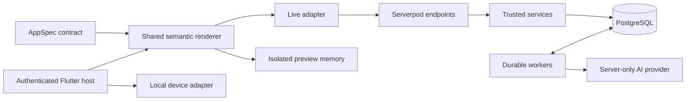

# AppNest architecture

[Documentation index](docs/README.md) · [Development](docs/DEVELOPMENT.md) ·
[Architecture review](docs/ARCHITECTURE_REVIEW.md)

This page describes the current implementation, including local working-tree
changes. It is a source contract, not a claim that every path has passed live
acceptance. See [requirements and dated evidence](docs/REQUIREMENTS.md) for
verification scope and the review for confirmed defects.

## One engine, fixed platform capabilities

Flutter host → LiveRuntimeAdapter → authenticated Serverpod endpoints → trusted application services → PostgreSQL. PreviewRuntimeAdapter implements the same renderer contract with isolated synthetic records and no network, membership or scheduler dependency. There is no per-app table generation, deployment, script evaluation, expression language, unrestricted widget tree or external automation destination.

| Source of truth | Responsibility |
| --- | --- |
| [packages/appnest_spec](packages/appnest_spec) | Definition types, validation, compatibility, patches, canonical hashes and fixtures |
| [packages/appnest_renderer](packages/appnest_renderer) | Semantic widgets, navigation, forms, preview and adapter contracts |
| [appnest_flutter/lib](appnest_flutter/lib) | Authentication, routes, live transport, authoring and local device consent |
| [appnest_server/lib/src/modules](appnest_server/lib/src/modules) | Trusted application services, policies and workers |
| [appnest_server/lib/src/models](appnest_server/lib/src/models) | Hand-authored `.spy.yaml` persistence models |
| [appnest_server/lib/src/endpoints](appnest_server/lib/src/endpoints) | Authenticated RPC and stream entrypoints |

Generated protocol/server/client files are outputs. Change their source models
or endpoints through the [development workflow](docs/DEVELOPMENT.md#changing-the-platform).

The pure-Dart `appnest_spec` package owns typed definitions, canonicalization/hash, strict parsing, semantic references, compatibility, semantic patches, bounded query validation and fixtures. Its [JSON schema](packages/appnest_spec/schema/appspec-v1.schema.json) and fixtures are exported with `dart run tool/export.dart` from that package. New labels, optional fields, choices and view combinations require no host rebuild. Adding a capability requires reviewed Dart platform code. The MVP permits one capacity pool per collection; multiple pools are rejected explicitly because the renderer exposes one capacity summary per record. Creating any capacity-backed record is builder/owner-only, even when combined with workflow behaviors.

Separate version domains: AppSpec language `formatVersion=1`; immutable published AppVersion ID and per-app number; each record's revision and written-under version; capability names such as `capacity.v1`; each automation's rule generation. Stable IDs survive label edits. Null/missing optional fields normalize to absence; required null/missing is invalid. Timestamps require an explicit offset and normalize to UTC. Display defaults do not rewrite old records. Member IDs are validated against current app access, never interpreted as grants.

## Persistence and query adapter

Optional `navigation.v1` definitions compose bounded semantic views into app-owned pages and tabs. Configured views provide explicit fields, predicates, ordering, local-day bindings and navigation destinations. `MiniAppController` owns typed page/record/edit state and leave guards; the authenticated host router maps it to browser URLs. The rich renderer preserves page state and uses app theme tokens. Definitions without navigation retain the original renderer and canonical serialization. The manual and AI builders use the same validated semantic edits. See [mini-app authoring](docs/MINI_APPS.md).

Navigation distinguishes forward, return and external route changes. The host stores an opaque session/index in route information to identify browser entries it owns. Returning from an editor traverses a known parent entry through Flutter's URL strategy; direct-link/native fallbacks and canonicalization replace the current entry. Rejected browser Back restores the original editor entry. External route changes trim renderer history, and generation checks prevent delayed navigation or obsolete discard dialogs from overwriting a newer destination. In-app and same-document leave guards do not install a cross-document `beforeunload` prompt.

New unpublished apps appear in Continue building using server-persisted drafts. Discovery requires current workspace membership and app builder access, selects only the current author's latest unpublished draft, and excludes archived apps. The `/drafts/<appId>` route survives refresh and resolves through the authentication gate; the server checks access again and resumes that same draft under the app row lock. Published launcher entries continue to use the active version, and live app routes reject unpublished manifests. Publication replaces the draft URL with the app URL. Draft definitions stay on the server and are not stored in browser route state.

`RuntimeAdapter` supplies record lookup, typed navigation, grouped summaries and reminder states to both isolated preview and authenticated live implementations. `runtime.summary` compiles the same validated predicates as queries and returns database-wide totals/choice counts in one app-locked transaction. Rich summary components use this operation rather than counting a loaded page. Relative-day predicates independently convert each local-midnight boundary to UTC; timestamp storage remains UTC.

The rich component library adds bounded `ViewSpec.options`, collection-free
banner/text/clock/timer views, and an opaque image field. `runtime.aggregate` computes
database-wide count/sum/average metrics, choice groups, and explicit UTC date
buckets using the same filter compiler and app lock. Calendar agendas retain
bounded record pagination. Both runtime adapters implement the same contract;
new capabilities preserve legacy canonical hashes and rendering. See
[rich components](docs/RICH_COMPONENTS.md) for the authoring and API contracts.

MediaAsset and MediaReference track private Serverpod image storage and its
draft/version/record owners. Upload authorization uses an editable draft or
approved record action. Only validated same-app ready assets can be referenced.
Authenticated byte reads recheck grants; no bearer download URL is persisted or
rendered. Reference updates share their owner's transaction. Sanitization runs
outside app locks, with processing leases and recoverable original/deletion
cleanup. Retained immutable versions protect media but do not grant readers
access to old images. Preview uploads stay in memory; the host can inject
authorized static images without exposing network clients to the preview.

Workspace, WorkspaceMember, MiniApp, MiniAppGrant, AppShortcut, Invitation, AppDraft, AppVersion, Template, GenerationJob, GuidanceRequest, EntityRecord, FieldValue, ResourcePool, Claim, ActionReceipt, OutboxEvent, AuditEntry, Automation, AutomationRun and Notification are stable platform models.

`EntityRecord.data` uses Serverpod's `dynamic, serializationDataType=jsonb`. The persisted representation is framework-owned; the serialization spike verifies round-trip values through the generated ORM. Queries **do not assume that dynamic JSONB is raw external JSON**. Validated fields are projected transactionally into typed FieldValue rows. Query compilation resolves field IDs against the active definition and uses fixed SQL/parameterized values, with up to eight filters, two sorts, 100 rows/page and deterministic ID tie-breaking. Cursor identity includes the validated query; a missing cursor anchor is an explicit stale-query failure. Summary counts are database-wide, not post-filtered pages. Grouped renderer summaries explicitly label page-local groups when pagination applies.

Generated native foreign keys enforce parent existence. Unique indexes cover grants, memberships, version numbers, receipts, pool/actor claim identities, occurrences and notification delivery keys. The companion `Integrity.ensure` transaction installs idempotent PostgreSQL tenant-consistency triggers and capacity/revision CHECKs not expressible in the selected model syntax. They reject mismatched repeated app/workspace IDs independently of endpoints. This is deliberate schema infrastructure, not per-app generated SQL. Startup runs it before demo seeding and worker registration. The server starts listeners immediately before this setup; block external traffic during startup for a future production deployment.

The `integrity` migration removes only obsolete pre-release custom FKs/indexes from this implementation before replacing them with generated equivalents; it does not delete records. Do not blindly apply a schema repair that drops companion checks/triggers. Fresh databases receive native relations from generated definition.sql and companion guards during normal startup. Acceptance tests explicitly install and verify these guards.

## Authorization and transactional commands

Identity comes from Serverpod authentication. Workspace membership is necessary but not sufficient: each app requires ownership or an explicit non-revoked grant. Queries, manifests, lists, invitation acceptance, members, audit history, inbox/read state and streams check authorization. IDs outside scope use safe errors. Members cannot change grants, capacity or workflow state through generic patch input.

Policy presets:

| Role/policy | Permitted work |
| --- | --- |
| Owner | Structure, sharing, all approved actions; owner-only archive |
| Builder | Structure, sharing, approved business actions; no archive |
| Member / personalTracker.v1 | Read only |
| Member / groupWorkflow.v1 | Create, edit ordinary fields/notes, assign eligible app members, approved status transitions |
| Member / groupCapacitySignup.v1 | Claim/release own place only |
| Viewer | Read only |

App-level serialization is the MVP tradeoff: lock the app control row, then record/pool and dependent rows. Publication, archiving and grants use the same app lock; record queries and aggregates also take it for a consistent authorized view. New-app quota checks lock the workspace. Per-actor quota advisory locks use distinct namespaces. No AI/network work runs inside these transactions. Bounded result sizes do not bound the number of database reads; the [review](docs/ARCHITECTURE_REVIEW.md#architecture-work-after-correctness-fixes) records hydration and lock-contention work to measure.

Commands recheck access, coordinate an app/actor/idempotency receipt, compare its canonical request hash, then validate definition/revision and dispatch a registered handler. A matching old receipt can return after republishing without executing again; a reused key with changed input fails. Capacity create+initial configuration, claim/reactivation and release lock the pool and atomically update typed counters/claims. Unique claim identity plus bounds prevent overbooking and double decrement. Ordinary edits use revision conflicts; protected fields are not generic payload edits. Business state, receipt, audit and outbox commit together.

Both renderer variants retain the original command key, input and record
revision after an unconfirmed response. Explicit Retry save replays that
request; other mutations stay blocked until recovery succeeds. Reconnecting
does not replay commands. This recovery state lasts for the mounted runtime,
not across browser reloads. A definite rejection permits a corrected request.
Revoking an assigned member still leaves a stale reference that can block
unrelated edits, as recorded in the [architecture review](docs/ARCHITECTURE_REVIEW.md#confirmed-findings).

Invitations are 256-bit unpredictable tokens stored only as hashes, seven-day expiry, single-use, revocable, role-selected and optionally bound to an authenticated account ID. Acceptance opens the same instance. Templates instantiate empty apps; remix copies structure only; unpin removes a shortcut; archive is read-only and suppresses effects.

## Builder and safe evolution

Durable jobs are persisted before an immediate Future Call wakeup. A recurring reconciler repairs missed dispatch and retries in bounded batches without waiting for model responses. Independent apps can generate concurrently; each app's row lock and each job's lease prevent duplicate execution without a global generation lock. All environments configure eight shared Future Call slots per server process. Generation calls the configured provider outside locks, validates and normalizes output, then conditionally saves the candidate only if lease, draft mutation and base version are current. Three attempts, bounded diagnostics and retries, one active job per actor, 30 jobs per rolling day. The job stores request text and bounded private repair/compilation metadata; it does not store a complete serialized provider HTTP request. Prompt/output bodies are not routine log fields. No private records are included. See [AI setup](docs/AI_SETUP.md) for configuration, response formats and scoped provider behavior.

Create and Send dispatch generation directly. The optional Help shape my idea flow checks the selected workspace or draft when the user requests clarification. The provider returns no questions for an actionable request or two or three questions with bounded, selectable choices when missing details materially affect the app. The check reserves one of 20 requests per actor per rolling day under a separate advisory lock, then calls the provider outside the transaction. Draft clarification sends only its declarative candidate definition, never records. The client keeps selections local and inserts a reviewable prompt into the existing composer; the check itself does not begin a draft or enqueue generation. Assessment failures expose built-in choices and an explicit continue path rather than trapping creation.

New definitions are untrusted complete specs; edits are bounded semantic patches. Trusted code allocates new patch IDs. Manual edits supersede old jobs. Exact-candidate publication checks candidate hash, expected current version and a review hash covering selected rules and existing-record scope. One transaction creates the immutable version, moves the active pointer, reconciles approved rules and records audit/outbox/receipt. Optional additions/presentation changes preserve existing data; destructive/type/required-field migrations are rejected. Definition history is not a data/effect backup.

Fresh AI creation sends no selected starter template, draft candidate or placeholder definition to the provider. Its system documentation includes a fixed public, validated reading-list example to demonstrate field/action/view/page ID linkage; this is not a starting definition or fallback, and the final user request determines the app. Failed attempts may receive their own bounded rejected output as untrusted repair context, stored privately on the generation job and scoped to the same job, draft mutation, base definition/version and generation mode. Semantic repair context can survive an intervening transient provider failure. Success, terminal failure and staleness clear that context. Template-first requests explicitly edit their selected definition; a successful AI candidate establishes edit context for later requests, including after failures or manual edits. Published drafts always use edits. One optional outer JSON fence is accepted before strict schema validation; prose and arbitrary JSON extraction remain rejected. Safe provider telemetry distinguishes transport, truncation, JSON and validation failures without logging prompt or output bodies.

For fresh creation only, a trusted compiler can add missing supported `requires`
declarations inferred from the model's authored graph, then strictly parse it
again. It does not invent fields, actions, rules or grants. The worker then
applies the default appearance and quality checks; private metadata distinguishes
the compiled candidate hash from the final normalized candidate hash. Manual
definitions and semantic edits retain strict validation.

## Durable work and live refresh

Business outbox rows retain independent planning/invalidation flags. The dispatcher deduplicates AutomationRun rows and schedules Serverpod Future Calls by run ID. Recurring reconciliation every ten seconds repairs interrupted scheduling and overdue work. Future Call exceptions are not assumed to auto-retry: run attempts, failure state and a next-attempt deadline are persisted. However, reminder execution currently does not enforce that deadline, so an early wakeup can bypass backoff; see the [confirmed finding](docs/ARCHITECTURE_REVIEW.md#5-p2--reminder-execution-ignores-persisted-retry-deadlines). Generation uses a separate attempt/lease path that checks its retry deadline.

Occurrence identity includes app, rule generation, source record and a hash of the schedule-relevant timestamp/intended due time. Unrelated note edits do not resend completed reminders. Changed/disabled/re-enabled rules do not silently enroll old records; publication review selects a bounded existing-record scope. Enrollment outbox events carry the approved automation ID and generation and remain durable evidence after processing, including records with no timestamp yet. Presentation-only publication preserves that evidence. Future outbox compaction must retain or migrate these enrollment rows. Legacy queued activation events retain their prior current-version restriction. At execution the app, rule, execution grant, source date/deletion state and recipient access are reloaded under the app lock. Active capacity claimants are resolved at delivery time. Notifications and successful run state commit together with unique delivery keys. This is a durable in-app guarantee, not an external email/webhook exactly-once claim.

Authenticated Serverpod streams emit only app revision invalidations. The current MVP polls the committed app revision server-side every two seconds and rechecks access on each iteration; it does not broadcast private record bodies. Flutter subscribes before fetching, buffers dirtiness, refreshes on reconnect/resume and every 30 seconds, and retries disconnected subscriptions. Rich views fence late reads and dismiss editors on errors. The legacy renderer clears its page but can retain an editor or accept a delayed query after an access error. Idle endpoint cancellation can also wait for a revision change. Both lifecycle gaps are [open findings](docs/ARCHITECTURE_REVIEW.md#confirmed-findings). Streams are not replay logs or offline write support.

Redis is intentionally optional/unused in this single-process local configuration. Before multiple event-producing instances, configure the selected Serverpod release's shared message backend/Redis, validate cross-instance invalidations and distributed worker behavior, and load-test. Current revision polling is database-backed but this is not a multi-instance verification claim.

## Chosen guardrails, not measured capacity

Personal reminders add the trusted `notifyOwner` effect and a bounded choice equality condition. The planner uses `status == Open`; its reminder timestamp is independent of its due timestamp. Reopening can affect eligibility of pending work but cannot revive a terminal occurrence. Manifests include approved rule IDs, typed reminder-state responses distinguish enrollment and execution state, and inbox record targets are derived from authorized automation runs. These additions reuse existing persistence, app locks, receipts, outbox and scheduler infrastructure.

The shared [Limits](packages/appnest_spec/lib/appnest_spec.dart) and provider,
media and server configuration set these guardrails:

| Area | Current bounds |
| --- | --- |
| Definition | 128 KiB, depth 12, 8 collections, 40 fields per collection, 16 views, 32 actions, 10 rules |
| Query / aggregate | 100 rows per page, 8 filters, 2 sorts; at most 366 aggregate buckets |
| Generation | 16 KiB request text, 3 attempts, 1 active job per actor, 30 jobs per actor per rolling day |
| Provider | 8,000 output tokens normally; fixed 12,000 on a recognized fresh-create truncation retry; 45-second generation deadline, or 90 seconds for the scoped development route |
| Scheduling | 100 worker rows per batch, 500 activation records or notification recipients, 8 shared Future Call slots per process |
| Media | 5 MiB per input, 500 assets and 250 MiB per app; framework request body limit 6 MiB |
| App / collaboration | 100 apps per workspace including unpublished apps, 50 invitations per actor per rolling day, capacity upper bound 10,000 |

Endpoint-specific input limits remain enforced. Further work waits when all
Future Call slots are occupied; provider RPM/TPM limits remain separate. The
shared pool is not a distributed rate limiter and does not guarantee reminder
latency. Capacity and notification fan-out have different bounds. These are
source guardrails, not measured throughput promises.

Structured framework request IDs and service action/run/job IDs accompany logs for reconciliation batches, scheduling lag, retries and generation failures. Raw private record/prompt bodies and provider secrets are not routine log fields. Production telemetry retention, alerting, external auth/email/storage and operational capacity are release gates, not implied by dependencies.

## Personal utilities

Clock and focus-timer views can compose collection-free apps. Device-local timer
state is scoped by backend, account, app, and component; preview timers use
independent memory storage. These views never introduce arbitrary device
actions or execute generated code. See [customization](docs/CUSTOMIZATION.md)
for the authoring, persistence, scheduling, and verification contracts.

## Device capabilities

Collection-free device views use the renderer's local DeviceCapabilitiesAdapter.
The native host owns per-backend/account/app consent and fixed Kotlin/Swift
commands; Serverpod stores only the declarative component configuration. Readings
never become server records or AI context. Foreground sessions, revocation, and
native lifecycle cleanup bound side effects; isolated previews cannot invoke the
bridge. See [the mobile contract](docs/MOBILE_FEATURES.md).
