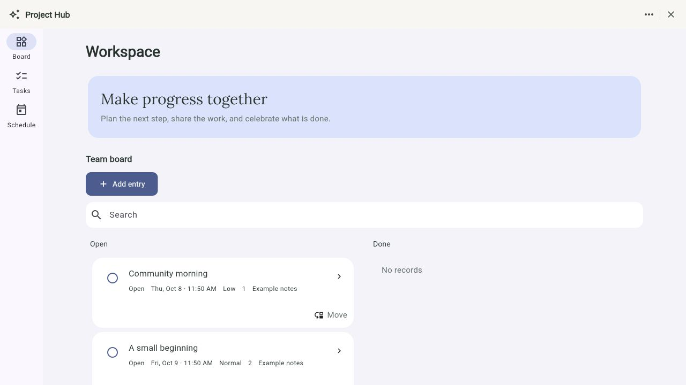
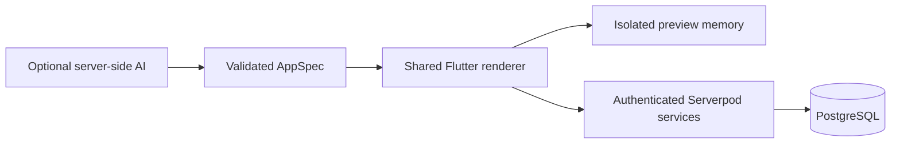

# AppNest

**Make everyday apps your own.**

Build personal tools and shared apps for notes, planning, chores, volunteer shifts, and more. Describe an idea or choose a template, try it with sample data, customize the details, and publish it for use in AppNest.

AppNest runs on Flutter, Serverpod, and PostgreSQL. Every mini-app is a validated declarative definition interpreted by the same shared renderer. Optional AI proposes definitions and edits; trusted Serverpod services handle authentication, shared records, permissions, and durable in-app reminders.

[Get started](#start-developing) · [Try the demo](#try-the-demo) · [Configure AI](#optional-ai) · [Documentation](docs/README.md)



*Local web app with synthetic demo data, captured during the [October 7, 2026 UI review](docs/UI_UX_REVIEW.md).*

## What you can build

| Experience | Supported features | Guide |
| --- | --- | --- |
| Personal utilities | Notes, reminders, calendars, clocks, and a device-local focus countdown | [Customization](docs/CUSTOMIZATION.md) |
| Shared apps | Pages, tabs, forms, record details, filters, assignments, workflows, capacity sign-ups, and approved inbox reminders | [Mini-apps](docs/MINI_APPS.md) |
| Rich content | Tables, timelines, charts, metrics, private images, multi-step forms, checklists, and workflow boards | [Rich components](docs/RICH_COMPONENTS.md) |
| App appearance | Clean, Editorial, and Playful styles; typography, spacing, colors, and page layouts | [Appearance](docs/APPEARANCE.md) |
| Native phone tools | Device information, flashlight, foreground brightness, keep-awake, and haptics with per-user consent | [Mobile features](docs/MOBILE_FEATURES.md) |

## From idea to live app

1. **Start with an idea or template.** Describe what you need when AI is configured, or choose a template and edit it manually. AI is optional.
2. **Try the preview.** Navigate pages, fill out forms, and test actions with isolated sample records. Preview activity cannot write live records or schedule reminders.
3. **Make it yours.** Use **Customize**, visual editing, or follow-up chat to change fields, views, appearance, and supported behavior. Unpublished apps can be reopened from **Continue building**.
4. **Review and publish.** **Use app** publishes the first version; **Apply changes** publishes an update. Review the exact candidate and explicitly approve requested reminders. Compatible updates preserve existing records; sample records stay in the preview.
5. **Use it together.** Invite people to the same app with role-based access. Shared record changes persist in PostgreSQL, and approved reminders appear in the in-app Inbox.

See the [creation flow](docs/CREATION_FLOW.md) and [visual editing guide](docs/VISUAL_EDITING.md) for the authoring experience. Publication activates a version inside AppNest; it does not deploy a separate application.

## Start developing

Use the verified toolchain: **Flutter 3.47.0, Dart 3.13.0, and Serverpod CLI/server/client/auth 4.0.0**. Package constraints and the committed [lockfile](pubspec.lock) record the workspace dependencies. Install the matching Serverpod CLI if needed:

```sh
dart pub global activate serverpod_cli 4.0.0
```

Make sure Dart's global executable directory is on your `PATH`, then clone and start the project:

```sh
git clone https://github.com/Xuefeng-Zhu/AppNest.git
cd AppNest
flutter pub get
dart run scripts/init_local.dart
cd appnest_server
serverpod start
```

If you already have the checkout, begin with `flutter pub get` from the repository root. The initializer creates ignored development/test secrets only when absent and preserves existing passwords. Serverpod manages real local PostgreSQL; the first run may download its binaries. Docker and Redis are not required.

`serverpod start` generates code, applies pending migrations during startup, watches source changes, and launches the configured Flutter companion app. **Open the companion app URL shown in the terminal UI** and keep that terminal session running.

| Service | Local address |
| --- | --- |
| Authenticated API | `http://localhost:8180/` |
| Insights | `http://localhost:8181/` |
| Backend web server | `http://localhost:8182/` |
| Managed PostgreSQL | `localhost:8190` |

Port **8182** serves the most recent release web build when one exists. Use the companion app URL for development; a release bundle must be rebuilt to reflect later source changes. Preserve the ignored `appnest_server/config/passwords.yaml` and `.serverpod` database directories.

For a physical phone, configure `SERVER_URL` with a backend address the device can reach; `localhost` refers to the phone itself. See [local development](docs/DEVELOPMENT.md) for builds, device configuration, migrations, and troubleshooting.

## Try the demo

Stop the existing development session, then run from `appnest_server`:

```sh
serverpod start -- --seed-demo
```

This explicitly seeds synthetic development accounts and example apps. Sign in as **Morgan** using the [demo account details](docs/DEVELOPMENT.md#synthetic-demo-accounts), select **AppNest demo**, and explore **Reading Journal**, **Chore Board**, and **Volunteer Shifts**. No AI credentials are needed for the template/manual walkthrough.

The [demo guide](docs/DEMO.md) walks through publication, invitations, concurrent sign-ups for the last place, compatible edits, and approved reminders. Keep the seeded environment local. For a static release-web demo at `http://localhost:8182/`, use the separate [release-web workflow](docs/DEVELOPMENT.md#release-web-demo-and-builds).

## Optional AI

Without a configured provider, the UI shows **Template mode — AI provider not configured**. Templates, manual editing, publication, shared records, and approved reminders remain available.

Add the following entries under `development` in the ignored `appnest_server/config/passwords.yaml`, preserving existing database and authentication secrets:

| Entry | Purpose |
| --- | --- |
| `AI_BASE_URL` | Provider API base URL |
| `AI_MODEL` | Supported model identifier |
| `NVIDIA_API_KEY` | Credential for the NVIDIA route |
| `AI_API_KEY` | Credential for other providers |

Use the credential entry matching your provider and restart the existing server to load changes. These are server password entries; `.env` files alone do not configure the adapter. Provider keys stay on the server, and stored mini-app records and device readings are excluded from generation context. Model output must pass AppNest's validation before it becomes a preview.

See [AI setup](docs/AI_SETUP.md) for supported routes, configuration examples, response formats, limits, retries, and troubleshooting. [Provider evaluations](docs/README.md#dated-evidence-and-investigations) describe dated results and their failures; they do not guarantee current availability or generation quality.

## How it works



The preview uses synthetic in-memory records. The live adapter calls authenticated Serverpod endpoints, which enforce workspace membership and app grants. Live writes use app-row locks, revision checks, command receipts, and atomic audit/outbox updates. Durable workers recover reminder work from PostgreSQL after interruption.

AI supplies declarative definitions and semantic edits. The platform never executes model-generated application code. See [architecture](ARCHITECTURE.md) and the [Serverpod feature map](docs/SERVERPOD_FEATURE_MAP.md) for the implementation boundaries.

## Verify changes

From the repository root:

```sh
bash scripts/verify.sh
```

The script runs workspace analysis, checks authored-source formatting, runs the spec/renderer/Flutter/server test suites, and verifies reminder recovery across separate processes. Server tests use real managed PostgreSQL, with no Docker prerequisite.

Release builds and live provider, browser, physical-device, and deployment checks are separate. See [focused verification commands](docs/DEVELOPMENT.md#verification), [dated verification records](docs/VERIFICATION.md), and [current acceptance gaps](docs/REQUIREMENTS.md#architecture-review-and-current-acceptance-gaps). The [architecture review](docs/ARCHITECTURE_REVIEW.md) preserves historical findings; requirements and [security limits](docs/SECURITY.md) record subsequent fixes and remaining work.

## Contributing

Read [AGENTS.md](AGENTS.md), [architecture](ARCHITECTURE.md), and [requirements](docs/REQUIREMENTS.md) before changing platform behavior. Follow the [development workflow](docs/DEVELOPMENT.md#changing-the-platform), including MCP-first migrations and reloads. The user starts the development session with `serverpod start`.

| Path | Responsibility |
| --- | --- |
| [packages/appnest_spec](packages/appnest_spec) | Pure-Dart definitions, schema, fixtures, semantic patches, compatibility, and query validation |
| [packages/appnest_renderer](packages/appnest_renderer) | Shared semantic UI, navigation, isolated preview, and runtime adapter contracts |
| [appnest_flutter](appnest_flutter) | Authentication, launcher, builder, routing, live adapter, and local device state |
| [appnest_server](appnest_server) | Authenticated endpoints, trusted services, platform models, migrations, and durable workers |
| [appnest_client](appnest_client) | Generated transport in `lib`; hand-authored verification tools in `bin` |
| [docs](docs/README.md) | Setup, feature contracts, operational limits, and dated evidence |

Change source models, endpoints, and services rather than generated server/protocol/client library files. New mini-app definitions reuse platform capabilities; new capabilities require reviewed Dart implementation.

## Current scope

AppNest is a **local MVP**. External notification delivery and background phone alerts, public deployment, payments, executable plug-ins, offline writes, and destructive data migrations remain outside its current scope.

Pending record commands can be retried with **Retry save** while the runtime remains open, but pending UI recovery state does not survive browser reload. Physical-device behavior, production operations, scale, and a full accessibility audit require separate acceptance. Start with [security and operational limits](docs/SECURITY.md), [requirements](docs/REQUIREMENTS.md), and the [documentation index](docs/README.md) for those boundaries.
