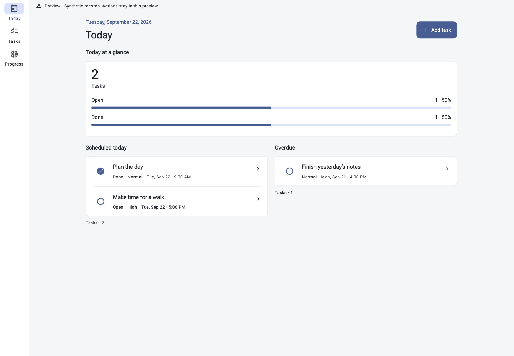
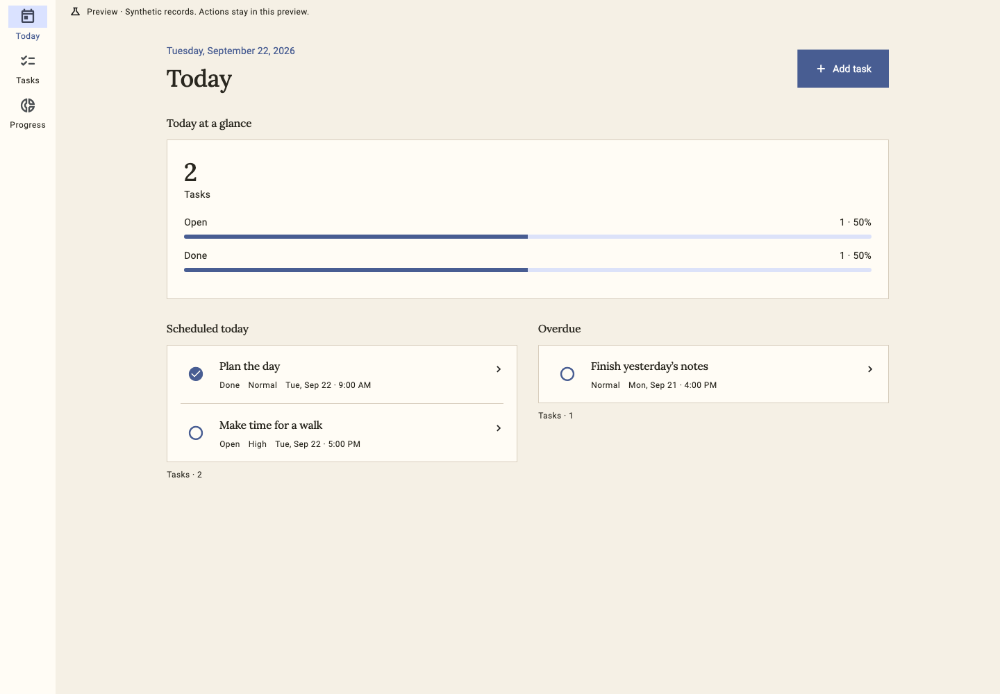
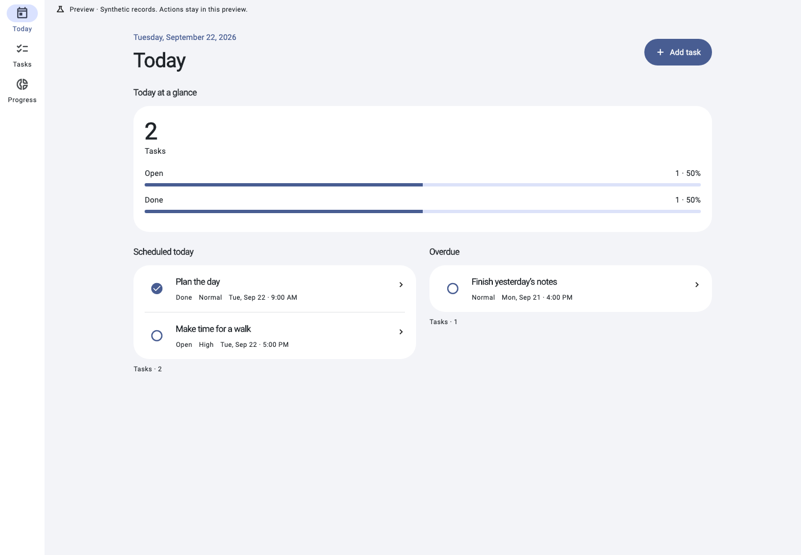
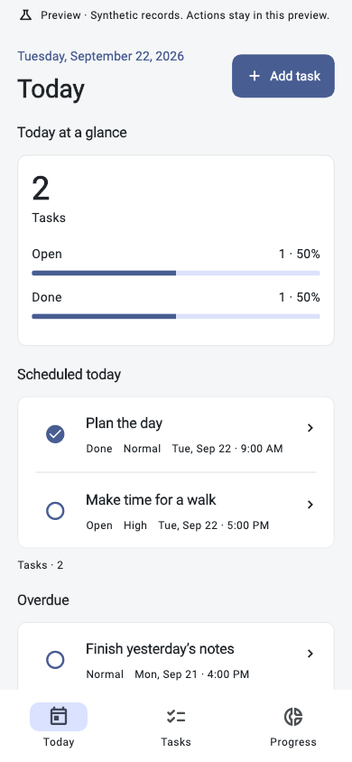
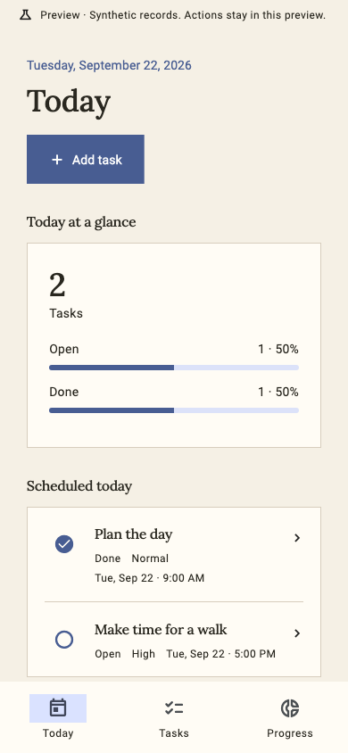
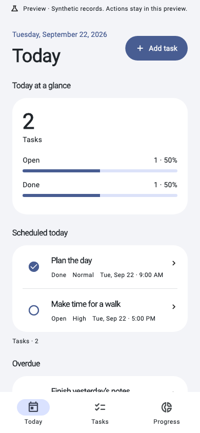
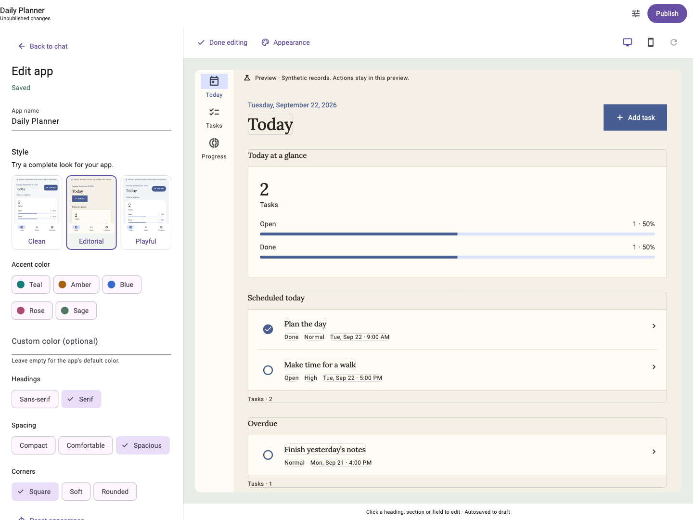
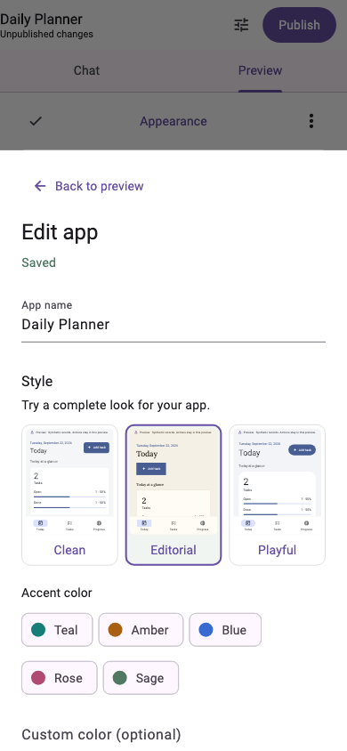

# App appearance and page layouts

[Documentation index](README.md) · [Mini-app navigation](MINI_APPS.md) · [Visual editing](VISUAL_EDITING.md) · [Component contract](RICH_COMPONENTS.md)

AppNest mini-apps can use a coordinated Clean, Editorial or Playful style,
custom accent colors, heading typography, spacing and corners. Pages can stack
sections, pair them in two columns, or feature a full-width first section.
These are validated presentation choices in the existing declarative app
definition. They do not generate executable UI code or change business rules.

Status: **implemented; automated integration checks and web build passed on
2026-09-23 UTC**. This is a dated evidence snapshot. The evidence below does not
establish connected browser, live-provider, native-device or production
acceptance for this release. Earlier
[rich-component verification](RICH_COMPONENTS_LIVE_CHECK.md) remains separate.

## Customize an app

In the builder, choose **Appearance** above the preview, or open
**Pages & navigation → Appearance**. The three style thumbnails use the shared
mini-app renderer. When an active preview is available, they use independent
copies of its current sample records and images.

| Style | Default character | Headings | Spacing | Corners |
| --- | --- | --- | --- | --- |
| Clean | Neutral surfaces, restrained borders and focused controls | Sans-serif | Compact | Soft |
| Editorial | Warm paper surfaces and lighter heading weight | Serif | Spacious | Square |
| Playful | Tinted background, bold headings and rounded controls | Sans-serif | Comfortable | Rounded |

Styles also coordinate cards, inputs, buttons, navigation, chips and supporting
text. Body text remains sans-serif; the typography control applies to headings.
The first release resolves these styles as light themes. The custom accent is
a color-scheme seed: foreground and container colors are derived together,
rather than placing the raw accent behind arbitrary text.

- Selecting a different style restores that style's heading, spacing and corner
  defaults while retaining an explicitly chosen accent color.
- Accent swatches and a six-digit hexadecimal input change the accent. Clearing
  the custom color uses the app's existing `theme` palette.
- **Headings**, **Spacing** and **Corners** override individual style defaults.
- **Reset appearance** retains the selected style and clears all overrides,
  including the custom accent. It does not restore the legacy renderer.
- Select a page heading in visual edit mode to choose **Page layout**, or use
  the Pages editor. A banner's component settings offer **Image placement**.

Visual inspector changes use the existing revision-aware draft save queue;
the full editor applies its choices with **Update preview**. Changes become
live only through the existing review and publication flow. Invalid color
input remains editable and must be corrected before the draft can be published.

AI can choose these styles and compositions during creation, or change them
through the same semantic operations as manual editing. Fresh AI definitions
that omit appearance receive `clean` before the candidate is saved. Existing
definitions and edits are not assigned a style merely by being loaded.

## Definition contract

`AppSpec.appearance` is optional. When present, it requires `style` and accepts
only these properties:

| Property | Accepted values | Omitted behavior |
| --- | --- | --- |
| `style` | `clean`, `editorial`, `playful` | Required within `appearance` |
| `accentColor` | `#RRGGBB` | Use the existing app `theme` palette |
| `typography` | `sans`, `serif` | Selected style's heading default |
| `density` | `compact`, `comfortable`, `spacious` | Selected style's spacing default |
| `corners` | `square`, `soft`, `rounded` | Selected style's corner default |

Hexadecimal input is case-insensitive and canonicalizes to uppercase. Unknown
keys, unrecognized choices, short/alpha hex colors and explicit null property
values are rejected. Resolved defaults are never inserted into serialized
definitions.

Each navigation page can optionally specify `layout` as `stacked`, `twoColumn`
or `featuredFirst`. A banner's `options` can optionally specify `imagePlacement`
as `above` or `beside`; it does not require an image to already be attached.

Capability declarations follow actual use:

- `appearance.v1` is required by a non-absent `appearance` or any explicit banner
  `imagePlacement`.
- `navigation.layouts.v1` is required by any explicit page layout, including
  `stacked`. Pages retain the existing `navigation.v1` requirement.
- Banner views retain their existing rich-component and navigation requirements.
  Appearance alone can also style an app without app-owned navigation.

`SetAppearance` replaces the entire appearance object. To preserve selected
overrides, include them in the replacement. The semantic patch
`{"type":"SetAppearance","appearance":null}` removes the property and restores
legacy appearance; null is a reset instruction in this patch, not a valid
serialized `appearance` value. `SetTheme` continues to change the existing
palette/icon without removing an appearance object.

`UpdatePage` still replaces the complete page payload, excluding its stable ID.
Include every unchanged page property when changing layout. Omitting `layout`
restores its original arrangement. `AddPage` can set layout atomically.
`UpdateView` similarly preserves the banner payload while changing its options.
Semantic patches add or remove the new capability declarations coherently:
clearing app appearance retains `appearance.v1` if a banner still needs it,
and removing one page's layout retains `navigation.layouts.v1` while another
page has an explicit layout.

## Responsive composition

The canonical section order remains `page.viewIds`. Layout choices change
placement, not queries, record ordering or action behavior.

- **Stacked** displays each section at full width, matching the original page
  arrangement.
- **Two columns** pairs consecutive eligible sections when the available page
  content width is at least 960 logical pixels and text scaling is below 150%.
- **Featured first** keeps the first section full width, then applies the same
  pairing rule to the remaining sections.
- Tables, calendars, boards, forms and details always remain full width. Record
  detail/edit contexts do not pair their sections. An unpaired final section
  also takes the full width.
- Narrower content or text scaling of 150% and above stacks all sections in
  their original order. Keyboard traversal follows reading order.

A banner uses image-beside-text only when an image exists, its available width
is at least 640 logical pixels and text scaling is below 150%. Otherwise its
image appears above its text. Without an image, the text remains a complete
banner. Images continue to use the existing authorized private-media pipeline;
AI cannot invent asset IDs, upload images or introduce external image URLs.

## Compatibility, preview and live use

Absent appearance, layout and image-placement properties remain absent in
canonical JSON. Existing immutable definitions and fixture hashes remain
unchanged. The legacy layout/theme path remains active until an explicit
presentation edit is published. `formatVersion` stays 1.

The same renderer resolves appearance for the builder preview, style thumbnails
and the published mini-app. The surrounding AppNest launcher, builder and
management chrome remain host UI. Preview presentation updates retain sample
records, claims, images and command receipts; thumbnail copies are isolated.
Behavior-changing definitions cannot enter that presentation-only update path.

Styles and layouts do not change collections, field types, stable IDs, record
revisions, queries, actions, permission presets, automation rules or media
authorization. Publication continues to use candidate/review hashes and the
existing compatibility checks. Preview records never become live records.

Appearance does not change the live record-command retry path or the separate
legacy renderer lifecycle. Their open ambiguous-Save and access-error findings
are described in the [architecture review](ARCHITECTURE_REVIEW.md). Passing
presentation tests does not establish that those client issues are fixed.

The source of truth is `packages/appnest_spec/lib/src/appearance.dart`, the
typed page/app models and rich-component validators. The renderer resolves
default tokens in `packages/appnest_renderer/lib/src/appearance.dart`; the
Flutter builder and server-side AI provider consume this same contract.
Regenerate `packages/appnest_spec/schema/appspec-v1.schema.json` with the
package's `tool/export.dart` after contract changes. Do not hand-edit Serverpod
generated models or client code for these presentation settings. App definitions
use their existing persisted JSON; no new database model is introduced.

## Historical verification status

Executed on 2026-09-23 UTC:

- `CI=true bash scripts/verify.sh` passed: workspace analysis, formatting of
  107 authored files, 61 spec tests, 115 renderer tests, 119 Flutter app tests
  and 51 server tests (346 tests total).
- Real PostgreSQL integration tests exercised appearance/layout publication,
  draft conflicts, authorization, record/revision preservation and unchanged
  reminder enrollment. Synthetic provider responses exercised creation and
  style-only editing across reading, plant and trip definitions. These are not
  credentialed live-model checks.
- The verification script's separate persistent-database, two-process restart
  checks passed: claimant and owner reminders recovered, completed tasks stayed
  suppressed and duplicate wake-ups did not resend notifications.
- `CI=true flutter build web --dart-define=SERVER_URL=http://localhost:8180/`
  passed and produced `appnest_flutter/build/web`. This build was not activated
  in the running development app.
- Eight isolated widget captures were visually inspected: the same planner/data
  in all three styles at desktop and mobile sizes, plus the builder's desktop
  inspector and mobile appearance sheet. Automated renderer coverage also
  checks large text, touch targets and retained preview state.

Serverpod and Dart MCP tools were unavailable in this session, so no development
server restart, connected browser/driver check or live-server log check was
performed. Connected preview-to-published visual parity, appearance-specific
live-AI behavior and native-device/production acceptance remain unverified.
Earlier connected checks must not be read as verification of this new release.

## Visual examples

These PNGs show the same planner, sample records and featured-first page layout
in all three styles. They are isolated renderer captures with the bundled Lora
font, not screenshots of a connected server. Desktop: 1440×1000; mobile:
390×844.

| Clean | Editorial | Playful |
| --- | --- | --- |
|  |  |  |
|  |  |  |

The builder captures use a synthetic client and sample data. Desktop:
1440×1080; mobile: 390×844.

| Desktop inspector | Mobile appearance sheet |
| --- | --- |
|  |  |
