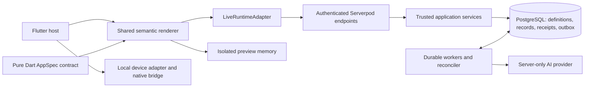

# AppNest architecture review

[Documentation index](README.md) · [Architecture](../ARCHITECTURE.md) ·
[Requirements](REQUIREMENTS.md)

Reviewed 2026-10-07 against `c6cbec69d7cb0e0cca654d284de47a97c5413f08` plus the existing uncommitted changes, including AI creation compilation, provider/repair changes, and numeric editor changes. `origin/main` was fetched and matched HEAD. This is a review; no product fixes were applied.

## Assessment

Keep the modular monolith. The declarative language, shared renderer, authenticated services, and transactional PostgreSQL runtime form a coherent foundation for multiple users. The most consequential gaps occur where client command identity, authorization lifecycle, and asynchronous scheduling cross module boundaries. Fix those before adding more capabilities.

The current source preserves important boundaries: model output becomes validated definitions or semantic patches; private records stay outside AI context; preview uses isolated memory; native side effects remain in a local adapter; business writes, receipts, audit, and outbox commit together. Splitting these services into independently deployed systems would add consistency work without resolving the findings below.

| Boundary | Current responsibility | Assessment |
| --- | --- | --- |
| `appnest_spec` | Parsing, capability/reference validation, canonical hashes, compatibility, semantic edits | Strong central contract; preserve stable IDs and legacy hashes. |
| `appnest_renderer` | Semantic views, forms, navigation, preview/runtime adapter interface | Good separation; legacy and rich lifecycle implementations have drifted. |
| Flutter host | Authentication, transport, routes, media transport, local device consent/state | Correct placement; command retry identity needs a longer lifetime. |
| Server services | Authorization, policies, commands, publication, sharing, media | Strong app transaction boundary; assignment revocation lacks reconciliation semantics. |
| Workers | Outbox planning, generation, reminder execution, recovery | Durable state is sound; retry deadlines and cancellation need explicit enforcement. |
| PostgreSQL | Platform tables, typed projections, uniqueness and tenant guards | Good integrity model; bounded responses do not yet imply bounded database work. |

## Confirmed findings

P1 means restore promptly because the delivery checks are blocked. P2 means a reproducible correctness or lifecycle defect to address in the next reliability milestone. Ordering also reflects practical fix priority.

### 1. P1 — CI cannot validate this workspace

All three workflows pin Flutter **3.44.4**, while the Flutter package requires **3.47.x** and the workspace requires Dart **3.13.x**. The latest Analyze, Format, and Tests runs for the reviewed commit all failed during dependency resolution: their Dart SDK was **3.12.2**. None reached the intended checks.

Evidence: [tests workflow](../.github/workflows/tests.yml), [analysis workflow](../.github/workflows/analyze.yml), [format workflow](../.github/workflows/format.yml), [workspace constraints](../pubspec.yaml), [Flutter constraints](../appnest_flutter/pubspec.yaml). Live failures: [Analyze](https://github.com/Xuefeng-Zhu/AppNest/actions/runs/37704508682), [Format](https://github.com/Xuefeng-Zhu/AppNest/actions/runs/37704508791), [Tests](https://github.com/Xuefeng-Zhu/AppNest/actions/runs/37704508603).

Even after correcting the SDK, the workflows target the server package and omit the spec, renderer, Flutter authoring suites, and restart recovery. The format workflow also formats files in place, unlike the authored-source check in `scripts/verify.sh`.

**Recommended change:** align CI with the verified toolchain and the workspace verification entrypoint. Separate fast checks from PostgreSQL/restart checks if needed, but make every platform boundary a required check. Remove obsolete Docker setup when using the configured managed test database. Add a clean-tree/generated-artifact drift check after intentional generation.

### 2. P2 — Save retry can duplicate a committed create

**Follow-up:** the UI/UX fixes retain the original key, payload and record
revision in both renderers, expose explicit recovery, and block competing
mutations while the outcome is unknown. Lost-response widget regressions cover
create and edit retries. Recovery remains in memory for the mounted runtime;
pending commands do not survive browser reload. The original reproduction below
describes the reviewed baseline.

The rich renderer creates a new timestamp-based idempotency key for every `_execute` attempt. A failed Save retains the editor and offers another attempt. If the server committed the first create but its response was lost, the second Save is a new command and bypasses the first receipt. The legacy renderer also creates keys per attempt.

Sources: [rich execution](../packages/appnest_renderer/lib/src/rich_runtime.dart#L561), [legacy execution](../packages/appnest_renderer/lib/src/runtime.dart#L175), [retained editor](../packages/appnest_renderer/lib/src/editor.dart#L144), [live forwarding](../appnest_flutter/lib/features/mini_app/live_adapter.dart#L216), [server receipt lookup](../appnest_server/lib/src/modules/runtime/commands.dart#L16).

**Reproduction:** an isolated widget adapter committed a create, threw a simulated lost-response error, then received the same retained form's second Save. Result: **two records and two command keys**. This proves client behavior with a synthetic adapter; the real server's receipt semantics were checked in source and its existing tests.

**Recommended change:** retain a pending command envelope containing its key, exact input, target, definition version, and record revision until acknowledged or explicitly abandoned. Retry that envelope after an ambiguous transport failure. If the user changes input, resolve or abandon the old command explicitly before allocating another key. Preserve the existing rule against automatic replay on reconnect.

### 3. P2 — Legacy authorization failure leaves or restores private UI state

The legacy stream error handler clears the page, but does not dismiss its record editor or invalidate reads already in flight. `refresh` accepts any eventual result while mounted. Consequently, an edit dialog can keep displaying private text after revocation, and a delayed successful query can repopulate the page after the access error.

Sources: [error handler](../packages/appnest_renderer/lib/src/runtime.dart#L46), [query result acceptance](../packages/appnest_renderer/lib/src/runtime.dart#L108), [modal creation](../packages/appnest_renderer/lib/src/runtime.dart#L138). The rich renderer already has a stronger policy: [modal dismissal and request fencing](../packages/appnest_renderer/lib/src/rich_runtime.dart#L116).

**Reproduction:** two isolated widget checks found (a) private text still present in the dialog after an access-revoked stream error, and (b) records restored by a query completed after that error. This is a UI lifecycle defect; it does not demonstrate unauthorized backend reads after revocation.

**Recommended change:** share one authorization/connection invalidation policy across both renderer variants. It must invalidate request generations, clear record state, close renderer-owned editors, and reject late reads. Cover both legacy definitions and navigation-enabled definitions with the same contract tests.

### 4. P2 — Cancelling an idle event stream does not stop polling promptly

`RuntimeEndpoint.events` uses an infinite `async*` loop and yields only when the control revision changes. After its initial event, an unchanged app can keep the generator inside its poll/delay cycle while cancellation waits for another yield. Closing a mini-app therefore need not release its server-side polling promptly.

Source: [event endpoint](../appnest_server/lib/src/endpoints/runtime_endpoint.dart#L51). The client explicitly attempts upstream cancellation when its last consumer leaves: [live subscription lifecycle](../appnest_flutter/lib/features/mini_app/live_adapter.dart#L258).

**Reproduction:** with the actual endpoint and real PostgreSQL, `subscription.cancel()` timed out after **2.5 seconds**, spanning a complete poll interval. It completed after an app mutation changed the revision and caused another yield. The test explicitly awaited cleanup. This is direct endpoint evidence, not a live WebSocket/RPC cancellation test.

**Recommended change:** make polling explicitly cancellable, with cleanup tied to subscription cancellation and session closure. A controller with a cancellable timer or cancellation signal can stop pending waits and future queries. Add a transport-level regression that repeatedly opens/closes an unchanged app and verifies the poll count returns to zero.

### 5. P2 — Reminder execution ignores persisted retry deadlines

Reconciliation selects pending runs through `now + 1 minute`, then executes past-due occurrences without checking `nextAttemptAt`. The execution transaction itself checks status and occurrence due time, but never the retry deadline. Direct scheduled calls use that same execution method.

Sources: [selection and retry persistence](../appnest_server/lib/src/modules/automation/worker.dart#L144), [execution guard](../appnest_server/lib/src/modules/automation/worker.dart#L264), [scheduled entrypoint](../appnest_server/lib/src/modules/automation/worker.dart#L879).

**Reproduction:** two real-PostgreSQL checks inserted a due, pending run with attempts `3` and its next retry **32 seconds in the future**. Both the scheduled entrypoint and reconciliation immediately delivered a notification, changed the run to `succeeded`, and incremented attempts to `4`. Repeated failures can therefore consume the retry budget earlier than its persisted backoff permits.

**Recommended change:** enforce `nextAttemptAt <= now` after acquiring the app lock and reloading the run. Distinguish scheduling an upcoming initial occurrence from retry eligibility. Centralize persisted failure/backoff handling for both direct scheduled execution and reconciliation; direct execution currently relies on later reconciliation to record rolled-back failures.

### 6. P2 — Revoking an assignee blocks unrelated record edits

Every patch and workflow transition validates all member-valued fields in the resulting record. Revocation changes the grant but leaves existing assignments intact. A previously valid assignee then fails validation during unrelated notes or status changes, including changes by the owner. The protected assignment field cannot be repaired through an ordinary patch.

Sources: [post-mutation validation](../appnest_server/lib/src/modules/runtime/commands.dart#L143), [member eligibility](../appnest_server/lib/src/modules/runtime/commands.dart#L262), [grant revocation](../appnest_server/lib/src/modules/collaboration/sharing.dart#L208).

**Reproduction:** real-PostgreSQL checks revoked a chore's assignee, then attempted an owner note edit and an owner workflow transition. Both failed with `invalidInput: Choose a member of this app`.

**Recommended change:** define assignment behavior at revocation. Either reconcile assignments atomically using the approved assignment semantics, or preserve historical references while requiring current eligibility only for newly assigned/changed values. Keep authorization checks on the actor performing the operation. Add revoke → edit → transition → reassignment regression coverage.

## Architecture work after correctness fixes

These are source-backed design risks, not measured throughput failures.

1. **Reduce database work while preserving consistency.** A page query holds the exclusive app lock, performs a full count and ranked pagination query, then loads each record and its pool sequentially; capacity rows add a claim read. At 100 rows this adds roughly **200–300 per-row queries** before the transaction releases the lock. Batch DTO hydration first, then evaluate keyset pagination, query indexes, and an explicit read snapshot/version strategy. Measure lock wait and p95 latency before relaxing the common lock. Sources: [page query](../appnest_server/lib/src/modules/runtime/queries.dart#L83), [hydration](../appnest_server/lib/src/modules/runtime/queries.dart#L157), [pool/claim reads](../appnest_server/lib/src/modules/runtime/queries.dart#L309).

2. **Isolate reminder/recovery capacity from AI latency.** Eight shared Future Call slots include AI requests lasting up to 45 seconds, or 90 seconds for the scoped development route. Eight concurrent generations can occupy every slot needed by reminders and reconciliation. Reserve capacity or separate generation execution while keeping the durable job/lease contract. Benchmark with eight deliberately stalled providers and a due reminder. Sources: [pool configuration](../appnest_server/config/development.yaml#L51), [provider deadlines](../appnest_server/lib/src/modules/builder/provider.dart#L1787).

3. **Index and manage durable history.** Generation jobs and outbox events lack secondary scheduling/access indexes; reconciliation scans every ten seconds while history is retained. Add indexes matching due-work, actor/time quota, and enrollment queries, based on query plans. Introduce retention without discarding idempotency outcomes or automation enrollment evidence; enrollment currently lives in outbox rows. Sources: [generation model](../appnest_server/lib/src/models/generation_job.spy.yaml), [outbox model](../appnest_server/lib/src/models/outbox_event.spy.yaml), [enrollment lookup](../appnest_server/lib/src/modules/automation/worker.dart#L46).

4. **Give validation diagnostics a typed contract.** The new creation compiler identifies missing capabilities by parsing a human-readable exception prefix. It fails closed safely, but wording changes can disable compilation behavior. Return an error code and structured missing-capability list from the spec package; keep display text separate. Source: [compiler diagnostic handling](../appnest_server/lib/src/modules/builder/creation_compiler.dart#L55).

5. **Complete operational boundaries before deployment.** Readiness must wait for companion integrity guards; startup currently starts listeners first. Separate schema-maintenance privileges from runtime privileges and exercise backup restoration, retention, production authentication/storage, and multi-instance behavior. These are already documented release gates, not newly discovered production incidents. Sources: [startup](../appnest_server/lib/server.dart#L90), [security and operational limits](SECURITY.md).

One additional source-confirmed management limitation deserves a follow-up: [the member directory](../appnest_server/lib/src/modules/collaboration/sharing.dart#L167) silently limits grants to 100 without pagination or an equivalent app-membership cap. Once that threshold is crossed, the management UI cannot show all members for assignment or revocation. Add cursor-based directory access or enforce and explain an explicit membership limit. This threshold behavior was not dynamically tested during the review.

## Verification and limits

- Workspace static analysis passed with `dart --suppress-analytics analyze --fatal-infos`.
- All **81 spec tests** passed with the Los Angeles timezone setting.
- All **259 server tests** passed against managed test PostgreSQL using concurrency one.
- All **92 focused renderer tests** passed: `runtime_test.dart`, `rich_runtime_test.dart`, and `rich_components_test.dart`.
- Eight targeted invariant checks exposed the defects above: three synthetic widget checks, two PostgreSQL retry checks, two PostgreSQL revoked-assignment checks, and one direct endpoint cancellation check. These were expected failing reproductions, not passing acceptance tests.
- Latest GitHub Actions results and their SDK-resolution errors were inspected live.
- No full verification script, new release build, restart smoke, live browser workflow, live provider call, physical-device check, or transport-level cancellation test was run for this review. Temporary backend repro files were removed. The widget reproductions used a temporary local test outside the repository; that file is not a maintained regression suite or portable evidence artifact. The reproduction descriptions above record the observed failures; add permanent regression coverage when fixing them.

## Suggested delivery sequence

1. Restore CI and make the relevant platform suites required.
2. Retain command identity across ambiguous failures and unify renderer invalidation/cancellation behavior.
3. Enforce reminder retry eligibility and define assignment behavior after revocation.
4. Batch reads, index durable work, and reserve scheduler capacity, using targeted load measurements.
5. Add capabilities only through the existing spec → renderer → trusted service → verification path.
