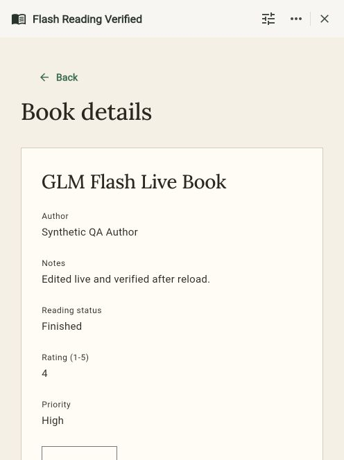

# GLM Flash real-app check — 2026-10-09

GLM 5.3 Flash created a usable local AppNest reading-list app. Authenticated record
creation, editing and browser reload persistence passed. A more complex field edit
failed all three attempts; a simpler follow-up succeeded. This is one local app
check, separate from the [synthetic model benchmark](NVIDIA_MODEL_COMPARISON.md).

The configured runtime now accepts exact model `z-ai/glm-5.3-flash` at NVIDIA's
`https://integrate.api.nvidia.com/v1` base, using the server-side `NVIDIA_API_KEY`.
Its existing low-effort, `clear_thinking: true` profile and 90-second per-attempt
bounds are retained. Other comparison models remain evaluation-only; experimental
Nemotron pipelines remain opt-in. See [AI setup](AI_SETUP.md) for configuration.

## Live generation

Durable job metadata proves the serving provider and exact Flash model for every
job below. All five attempts returned HTTP 200; no transport timeout occurred.
Provider times exclude local queue/pacing time.

| Job | Request | Outcome | Attempts | Provider time |
| --- | --- | --- | --- | --- |
| 108 | Create Flash Reading Check with searchable Books, title/author/notes/status/rating, and add/edit forms | Accepted | 1 | 48.959 s |
| 109 | Rename and add optional Priority to list, detail and editor | Failed: `Unknown field priority` | 3 | 22.096 + 31.099 + 61.224 s |
| 110 | Rename and add optional Priority to editor and detail, retaining other structure | Accepted | 1 | 38.927 s |

The rejected edit added a field and then referenced guessed ID `priority` in an
UpdateView patch. AppNest allocates the added field's ID; validation rejected the
unknown reference on each attempt. The accepted definition remained intact and
usable in preview. The successful simplified edit does not establish the original
requested list-column change works. The resulting app is **Flash Reading Verified**.

## Application checks

- Signed in through the real UI as synthetic local Morgan, using that account's
  personal workspace. All live writes went through authenticated Serverpod RPCs.
- Preview search filtered three synthetic books to one matching result; detail
  navigation and an isolated preview edit/save worked.
- Reloaded the unpublished draft: name, Priority choices and pages persisted.
- Published only the synthetic local app as version 125. Its candidate hash
  matched the saved draft, and the live collection contained zero records;
  synthetic preview records were not copied.
- Saving an empty title showed `Title is required` and retained the form.
- Created **GLM Flash Live Book** with synthetic author, rating 4 and Priority High:
  record 283, revision 1. Edited its Notes and status to Finished: the same record,
  revision 2, with no duplicate.
- Reloaded the live detail page: the edited note, Finished status and High priority
  remained visible. Database state still contained exactly one record. Audit rows
  recorded publication, creation and patch.
- Browser console warning/error query was empty after final reload. Captured server
  and Flutter output contained no unhandled error during these flows; the model's
  validation failure is retained above.

## Evidence and limits

The [evidence directory](evidence/glm-flash-live/2026-10-09/) includes serving-model
metadata, scoped app/version/record/audit snapshots, selected server log lines,
source fingerprints, a screenshot and checksums. Two initial provider log lines
were recovered from the captured CLI output in this chat; later lines were saved
directly from the terminal output. It contains only synthetic QA
content and no credentials.

This check used the local working tree, including pre-existing uncommitted builder
changes preserved outside this publication. It is not standalone proof of the
clean published commit. Flutter 3.47.0, Dart 3.13.0 and Serverpod 4.0.0 were used.
Serverpod/Dart MCP tools were unavailable; the user explicitly requested official
CLI startup, and browser checks used CUA. The current development companion URL
was `http://localhost:58850/`; the static release bundle on 8182 is a separate build.
The CLI warned that its initial Flutter VM-service attachment timed out, while the
web app subsequently loaded and published a debug service. Attached CLI hot reload
was not tested.

The runtime route's 106 focused provider tests and strict analysis passed. Those
mock-response tests are separate from the live evidence above. This check does not
establish native-device behavior, production deployment, broader multi-user or
concurrency acceptance, enforced rating range, or representative model reliability.
