# AppNest UI/UX review — 2026-10-07

AppNest has a coherent, calm visual identity and understandable navigation. The main opportunity is to make everyday use as prominent as app creation, and to adapt information and actions to phone screens. Keep the typography, restrained palette and clear page structure; improve hierarchy and recovery before pursuing a visual redesign.

## Fix follow-up

The prioritized findings below now have implementation changes: authenticated
private draft discovery and `/drafts/<appId>` routes; retained-command save
recovery; phone task cards; app-first returning-user navigation; template
descriptions and isolated sample previews; inline validation and first-error
focus; compact phone banners and labeled metadata; consistent account tools and
explained invitation roles; and readable inbox times. Editors have bounded
desktop width, single-choice radio semantics, larger touch targets and headings.
Draft cards also reflow at 320px with 200% text.

Current verification: the complete `scripts/verify.sh` entrypoint passes,
including analysis and formatting; 82 spec, 225 renderer,
197 Flutter host and 265 real-PostgreSQL server tests pass. The release web build
succeeds. Separate-process claimant and owner reminder recovery passes after
correcting the restart probe to match outcomes by record ID rather than run
insertion order; duplicate wakeup and completed-task suppression checks remain.
The rebuilt frontend was inspected at 390×844 and 1280×720; app-first
navigation, contextual task actions, desktop tables, editor semantics, sample
previews, focused inline validation, account tools and reminder dates were
verified. No browser console warnings or errors were observed. Validation used
isolated synthetic preview records after automatic approval review blocked an
invalid-save check on an existing demo record.

In the later explicitly authorized live check, the accessibility clear action
did not update Flutter's form before Save was pressed once. The app accepted
the original values and returned Saved; this did not establish empty-field
validation. A keyboard clear was then visually confirmed, canceled/discarded
without another Save, and the app reloaded. The persisted task still read
Community morning with its original visible values and three total records.
The first Save may have changed revision/audit metadata; no claim of zero
backend writes is made. That first attempt was inconclusive.

The subsequent authorized live check confirmed Task was visibly empty before
pressing Save once. The editor stayed open, showed `Task is required` beside
the field, and focused Task in the accessibility tree. Cancel → Discard →
reload restored the board with Community morning, its original visible field
values, and three records. No browser console warnings or errors were observed.
This establishes live required-field validation and cancel/reload behavior;
no database revision or audit comparison was performed.

The running backend still serves its previous template descriptions; connected
draft recovery and the new descriptions await the user's server restart.
Draft privacy and recovery are covered by committed database sessions and
synthetic route tests. Unconfirmed record-command recovery remains in memory
for the mounted runtime and does not survive browser reload. The original
review and screenshots below describe the baseline, not the rebuilt frontend.

## Scope and evidence

Reviewed the running local web app in Codex's in-app browser at **1280 × 720** and **390 × 844**. Used the existing signed-in session, the empty “My workspace,” and the existing “AppNest demo” / “Project Hub” app. All 13 screenshots below were captured, saved and inspected during this review. Phone-width screenshots are browser evidence, not physical-device testing.

The working tree was already dirty. Origin was fetched; HEAD and origin/main were aligned at `c6cbec6`. Product source and existing changes were left untouched. Source findings below describe the current working tree. Port 8182 can serve a previously built release, so visual findings and source findings are identified separately; parity with a fresh build was not established.

The user goals were to find an existing app, understand template choices, inspect tasks, open a record, edit/cancel, and find reminders. No app, record, invitation, publication or reminder was created or changed. Opening “Use template” was rejected by automatic approval review because it might persist an app. The builder, generation and publication sequence therefore remains unreviewed.

## Prioritized findings

P1 means a risk to work recovery or confidence in saved data. P2 means significant friction or clarity problems. P3 means visual polish.

| Priority | Finding and evidence | User impact | Recommended change |
| --- | --- | --- | --- |
| P1 | **New unfinished apps have no durable discovery path.** Source only; not reproduced through creation. Resume cards use an in-memory map; launcher reload fetches published apps but no drafts; the server list joins active versions. Sources: `home_screen.dart:41–43,119–123,929–947`; server `definitions/apps.dart:167`. | Reopening the browser can make saved, unpublished work appear lost. | Add an authenticated persistent Drafts / Continue building list and a resumable draft URL. |
| P1 | **An ambiguous save can invite an unsafe retry.** Source only; no network-failure experiment. Each action execution creates a new command ID, while the editor re-enables Save after failure. Sources: `rich_runtime.dart:573–577`; `editor.dart:168–173`. | If a create succeeds but its response is lost, retry can create a duplicate. | Retain the command ID and payload until the result is known; recover the receipt and explain “Checking whether your changes were saved.” |
| P2 | **Mobile table actions are hidden, then lose their record context.** Steps 9–10. Initially only Task and Priority are visible. Horizontal scrolling reveals Actions while Task disappears; no persistent scroll cue is visible. Source: `rich_components.dart:314–322`. | Users may miss Open/Edit or act on the wrong row after scrolling. | Use compact record cards on phones, or pin the task name and provide an always-visible row menu. Preserve a visible horizontal-scroll affordance if keeping the table. |
| P2 | **Home prioritizes creation over returning to apps.** Steps 1, 3 and 11. At phone width, none of the five existing apps is visible in the first viewport. Source: `home_screen.dart:952–954`. | Daily use requires scrolling through onboarding content. | When apps exist, lead with recent/pinned apps and drafts; offer a compact Create app entry. Keep the full composer for an empty workspace. |
| P2 | **Template choice lacks useful explanations.** Steps 2 and 12. Several unrelated desktop templates share “Bring people together, one place at a time.” Phone layouts remove descriptions altogether. Source: `home_screen.dart:616–620`. | Users must guess what a template does before committing to creation. | Give each template an outcome-based description, example screenshot and personal/shared indicator. Stack its description below the name at narrow widths; offer a read-only preview. |
| P2 | **Form errors need field-level recovery.** Steps 6–7 show the form; error behavior is source-only. Parsing and normalization failures feed a general error below the fields, without field error state, focus or an explicit live region. Sources: `editor.dart:221–227,389–401`. | Users, especially those on long forms or assistive technology, may not know which value to fix. | Validate individual fields, show actionable messages next to them, focus/scroll to the first error, and announce the failure. |
| P2 | **Operational screens spend too much space on welcome content.** Steps 4 and 8. The phone board shows one complete task before scrolling; the banner consumes substantial space. Record metadata is small and combines unlabeled values such as priority and effort. | Users scan less work at once and have to interpret compressed metadata. | Make the welcome banner compact or dismissible after first use. Use clear priority chips and labeled effort/due metadata. |
| P2 | **Mobile account tools are inconsistent with desktop.** Step 11 plus source. Mobile exposes New workspace and Sign out directly; desktop has an account menu with Copy my account ID. Invitation roles are raw `member/viewer/builder`; account ID targeting is optional, with link invitations available. Sources: `home_screen.dart:518–541,1105–1117`; `mini_app_screen.dart:316–330`. | Account discovery differs by device, and permission choices are hard to assess. | Use a consistent account menu on both layouts. Explain each invitation role; keep optional account-ID targeting under an advanced option. |
| P3 | **Inbox timestamps look like database output.** Step 13 shows dates with seconds and microseconds. Source: `home_screen.dart:1084`. | Reminders feel unfinished and are harder to scan. | Show localized “Today, 7:04 PM” or relative dates, with exact time available on demand. Keep reminder content consistent with privacy choices. |

## Strengths and accessibility observations

The host has a recognizable identity, readable primary headings and consistent surfaces. Existing apps open into a focused shell. Mobile bottom navigation exposes selected tabs to the accessibility tree. Close, Back, Edit, Save and Cancel have meaningful labels; the date control explicitly explains device timezone. Record detail → edit → Cancel returned to the same record successfully.

Accessibility risks requiring follow-up:

- Template buttons all expose the same “Use template” name. Include the template name in each button's accessible label so a controls list is understandable without surrounding context (steps 2 and 12).
- Priority is visually a single-choice group, but its options appear as checkboxes in the accessibility tree. Use radio/selection semantics and a group label (steps 6–7).
- The page titles inside the app, such as Task editor, and launcher section titles appear as plain text in the inspected tree. Verify heading navigation and apply heading semantics where appropriate (steps 1, 6 and 12).
- Small gray task metadata and compact circular controls deserve measured contrast and target-size checks (steps 4, 7–8). No contrast ratio or conformance claim is made from these images.
- A single Tab press reached New workspace from the inbox. This confirms basic keyboard traversal only; full tab order, focus visibility, screen-reader announcements, text scaling, zoom and switch access remain untested.

## Captured walkthrough

### 1. Desktop home — clear first-use prompt; weak return-user hierarchy

The creation prompt is the obvious next action. Existing-app access is below the large composer; the empty-workspace message offers little illustration of the eventual result. Accessible section-heading structure needs verification.

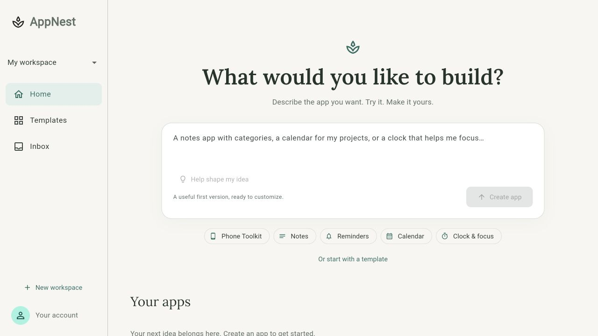

### 2. Desktop templates — scannable, but explanations are inconsistent

Rows align well and actions are predictable. Several templates have the same generic description and sparkle icon; repeated button names lack standalone context.

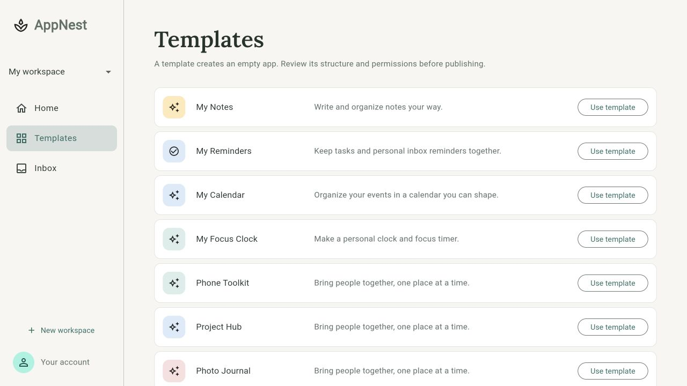

### 3. Existing app launcher — understandable after scrolling

Cards communicate names and record/capacity summaries. They are reachable only after passing creation content; a recent-app shortcut would reduce repeat effort. Test-data names with timestamps are fixture content, not a product naming defect.

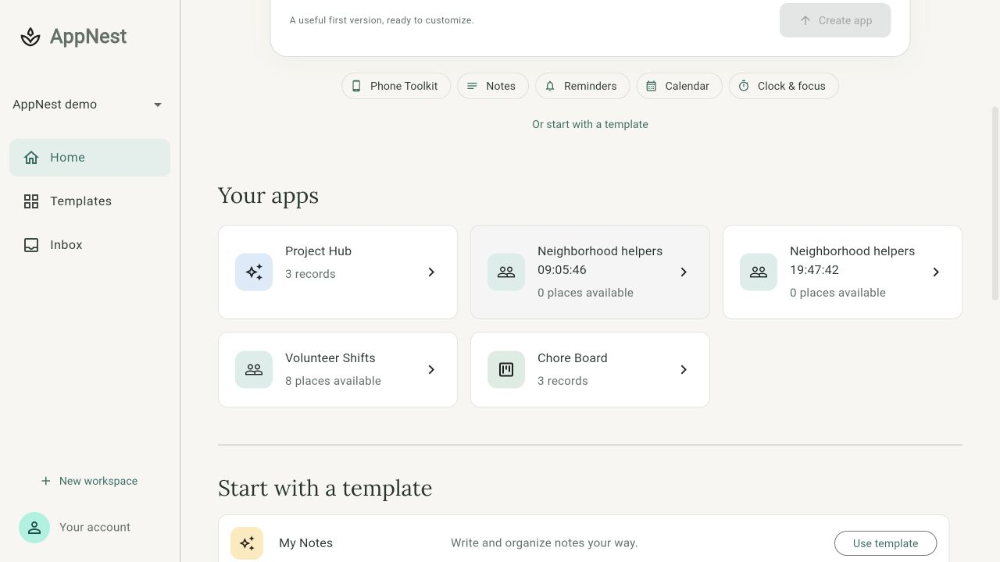

### 4. Project Hub desktop board — clear navigation; low information density

Board / Tasks / Schedule provides a simple mental model, and Add entry is visible. The banner and generous spacing push tasks down; small concatenated metadata makes scanning harder. Mark done and Move were inspected but not activated.

### 5. Record detail — clear and usable

Labels make the record easy to understand and Edit entry is explicit. The card is much wider than its content on desktop. Back and Close mini-app have distinct labels; full keyboard behavior was not tested.

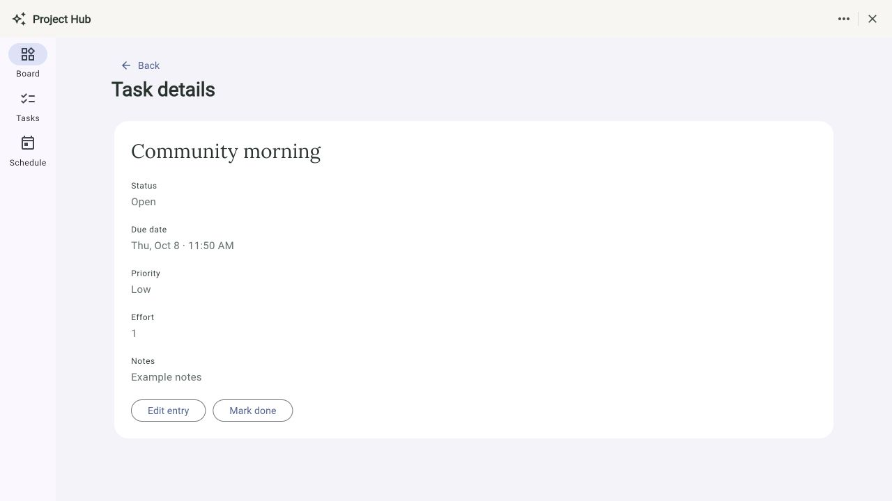

### 6. Desktop record editor — understandable controls; oversized layout

Required Task and device timezone guidance are helpful. Fields span a very wide card and Save is below the initial 720px viewport. Error recovery findings are source-only; no save was submitted.

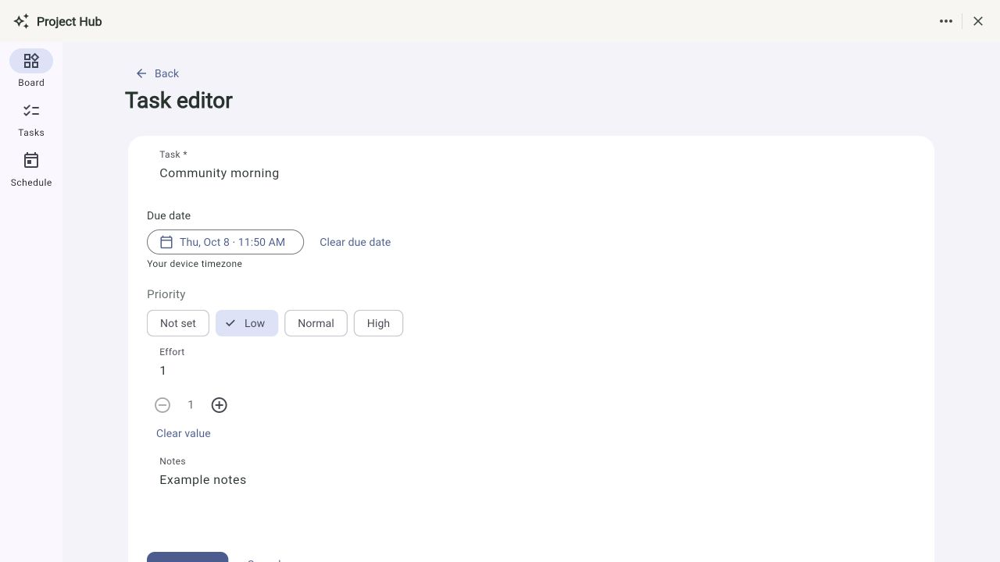

### 7. Phone-width editor — good reflow; semantics need attention

Choices wrap without clipping and Save/Cancel are visible at this height. Priority uses checkbox semantics despite single selection; small stepper controls need target-size verification. Cancel was exercised successfully without editing a value.

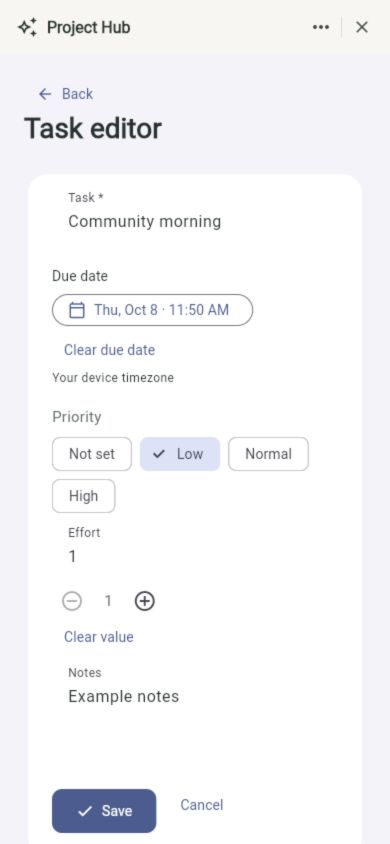

### 8. Phone-width board — usable navigation; welcome banner dominates

Bottom navigation remains visible. One complete task fits above it; welcome content could collapse to expose more work. Task metadata is small and effort appears as an unexplained number.

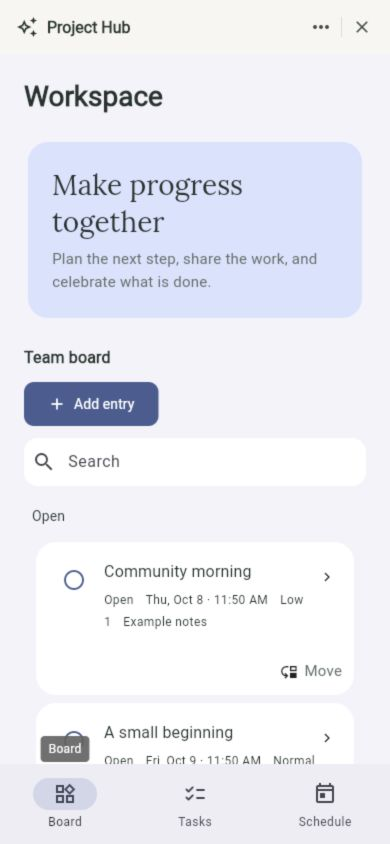

### 9. Phone-width task table — actions undiscoverable at first

Task names are readable, but due date, effort and actions are offscreen with no persistent cue. Quick check-in below repeats task functionality. A mobile summary/card layout would expose essential actions without panning.

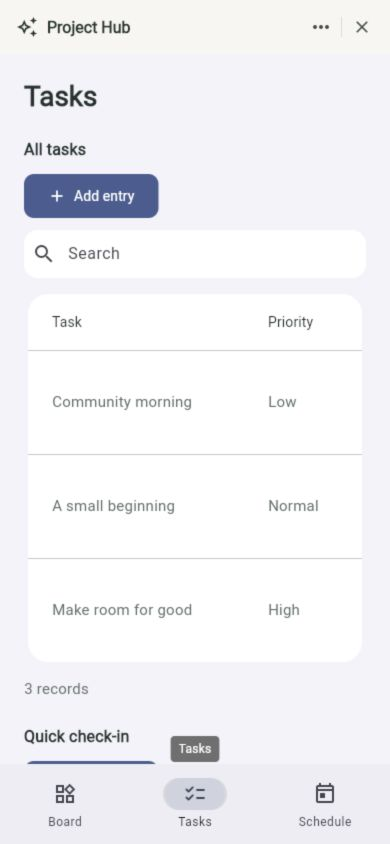

### 10. Task table after horizontal scrolling — actions are visible but lack identity

Scrolling reveals Open record and Edit entry; Task names disappear. Preserve identity alongside the action. The accessible tree includes the offscreen cells, but actual screen-reader table navigation remains unverified.

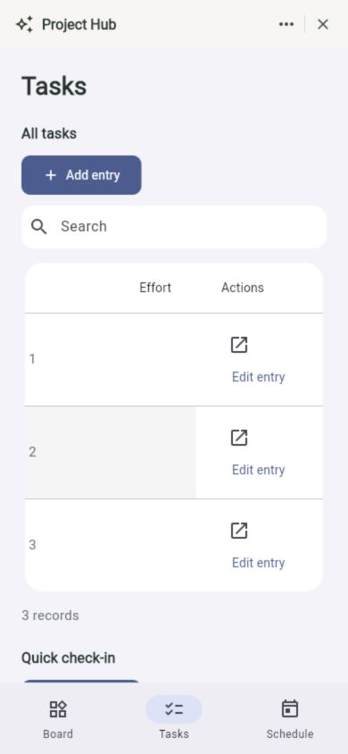

### 11. Phone-width home — clear creation; existing apps hidden below fold

The full initial viewport is devoted to creation, despite existing apps in this workspace. Direct Sign out occupies a prominent header position while account tools are missing. The creation input was not submitted.

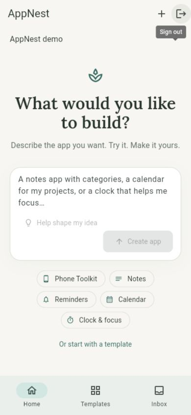

### 12. Phone-width templates — incomplete decision support

Names and Use template remain visible, but all descriptions disappear. Stack meaningful descriptions and provide a preview before creating. Builder entry was blocked by automatic approval review, so creation is not part of this walkthrough.

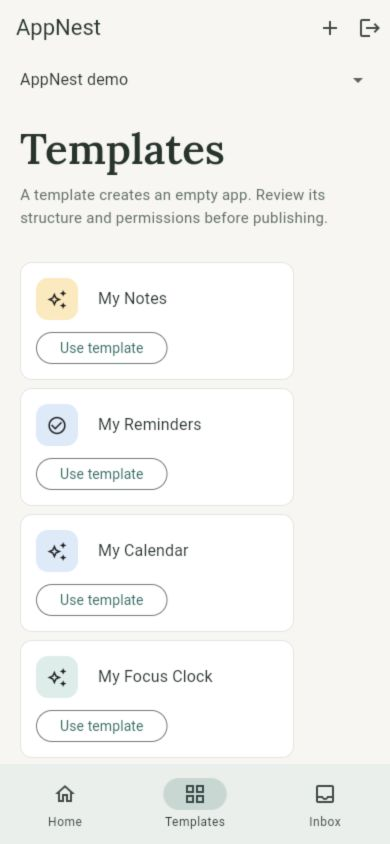

### 13. Phone-width inbox — readable reminders; unfinished dates

Reminder cards are easy to recognize, but raw timestamps add noise. Read/unread is differentiated by icon; verify that status is also announced explicitly. Items were not opened because opening marks them read.

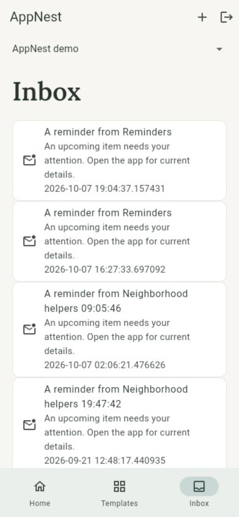

## Suggested implementation order

1. Protect work recovery: persistent drafts, reliable save outcome/retry, and inline form errors.
2. Improve daily use: recent apps before the composer, phone task cards or pinned identity/actions, and compact board banners.
3. Improve choice and consistency: useful template descriptions/previews, contextual accessible labels and a shared account menu.
4. Polish: localized inbox time, metadata labeling, desktop content width, and measured accessibility verification.

This review does not establish AI creation quality, publication behavior, save/network-failure behavior, permissions across multiple roles, reminder delivery, native-device behavior or WCAG compliance. Those require separate authorized interaction and testing.
